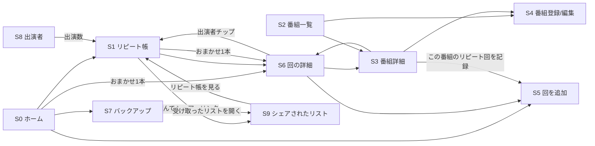

# システム要求仕様

最終更新：2026-11-26 ／ 対象バージョン：1.5.0 ／ DB スキーマ：v3

> 実装の「何を・なぜ」をまとめたものです。コードを変えたら、関係する節（特に 5〜8 章と 11 章）も更新してください。
> 要求には ID を振っています（FR=機能要求、NFR=非機能要求、DR=データ要求）。相談するときは ID で指すと話が早いです。

---

## 1. 目的と範囲

- **目的**：ラジオ／ポッドキャスト（YouTube・配信のアーカイブも可）の「また聴きたい回」を、放送・配信日（任意）・番組・出演者・理由メモ・聴ける場所のリンク（任意）とともにストックし、あとで探して聴き返せるようにする。
- **利用者**：個人（シングルユーザー）。アカウント・ログインなし。
- **範囲外**：音声・動画の再生（埋め込み含む）・録音、放送局サービス（radiko 等）との連携（リンクで開くのみ）、複数端末の自動同期。他ユーザーとの共有は「選んだ回をリンクで渡す」（S9）だけで、相手のデータを見たり自動で同期したりはしない。

## 2. 前提・制約

| ID | 制約 |
| --- | --- |
| C-1 | **無料で運用**する。有料サービス・独自ドメイン・サーバーは使わない |
| C-2 | **法令・各サービス規約に違反しない**（外部 API は公開・無料・キー不要のもののみ、規約の範囲で） |
| C-3 | リポジトリは **Public**。コード・テスト・ドキュメントに**個人情報や実在の個人聴取ログを含めない**。サンプルは「架空〜」で作る |
| C-4 | データは**端末のブラウザ内（IndexedDB）にのみ**保存し、外部に送らない（例外は利用者が自分で選んで送るリスト共有のリンク／ファイルのみ。サーバーには保存しない） |
| C-5 | 公開は **GitHub Pages のサブパス**（`/radio-log/`）。`main` への push で GitHub Actions が自動デプロイ |
| C-6 | 開発者はスマホ中心で操作する。ローカルで npm を使えない前提でも、push すれば CI がビルドする構成にする |

## 3. 技術構成

| 項目 | 採用 | 理由 |
| --- | --- | --- |
| UI | React 19 + TypeScript（strict） | 型安全・保守性 |
| ビルド | Vite 7 + `@vitejs/plugin-react` | 高速、GitHub Pages 用 `base` 設定が容易 |
| PWA | `vite-plugin-pwa`（Workbox、`registerType: 'prompt'`） | オフライン起動、更新は利用者が「更新」を押して反映 |
| ルーティング | `react-router-dom` の `HashRouter` | GitHub Pages のサブパスで 404 を出さない |
| DB | IndexedDB（自前の型付きラッパー `src/db/idb.ts`） | 依存を減らし、トランザクションを明示的に制御 |
| スタイル | 素の CSS ＋ CSS 変数（`src/styles.css`） | 依存なし。レトロアメリカン・ラジオ調ライトテーマ |
| アイコン | `assets/icon.svg` から `sharp` でビルド前に PNG 生成 | バイナリをリポジトリに置かない |
| CI/CD | `.github/workflows/deploy.yml` | push → `npm ci/install` → `npm run build` → Pages へデプロイ |

### ディレクトリ

```
src/
  db/          types.ts / idb.ts（接続・トランザクション）/ repo.ts（CRUD・整合性）/ backup.ts（JSON 検証）
  state/       DataContext.tsx（全データのスナップショットと派生 Map）
  lib/         util.ts（日付・正規化・検索）/ external.ts（iTunes・Wikipedia）/ suggest.ts（よく出る人）
               shareImage.ts（Canvas 描画）/ backupActions.ts（共有・最終バックアップ管理）/ stations.ts
  components/  Layout（ヘッダー・下部ナビ）, UiProvider（確認ダイアログ・トースト）, PersonPicker,
               PersonListEditor, ProgramNameSuggest, StationChips, SuggestInput, LogCard,
               RandomPickModal, ShareImageModal, BackupReminder, GuideContent, UpdateBanner
  pages/       HomePage, LogListPage, LogFormPage, LogDetailPage, ProgramListPage, ProgramDetailPage,
               ProgramFormPage, PersonsPage, DataPage
docs/          この設計ドキュメント
```

## 4. 画面一覧と遷移

| ID | 画面 | ルート | 下部ナビ |
| --- | --- | --- | --- |
| S0 | ホーム | `#/` | ホーム |
| S1 | リピート帳（一覧） | `#/logs`（`?person=ID`…、`?sort=`） | リピート帳 |
| S2 | 番組一覧 | `#/programs` | 番組 |
| S3 | 番組詳細 | `#/programs/:id` | |
| S4 | 番組登録／編集 | `#/programs/new`、`#/programs/:id/edit` | |
| S5 | 回の追加／編集 | `#/logs/new`（`?programId=`）、`#/logs/:id/edit` | ＋回を追加（中央） |
| S6 | 回の詳細 | `#/logs/:id` | |
| S7 | データのバックアップ | `#/data` | （ホームから） |
| S8 | 出演者 | `#/persons` | 出演者 |
| S9 | シェアされたリスト | `#/shared/:token`（リンクで受け取り）、`#/shared`（ファイルから開く） | （リンク・データ画面から） |

旧ルート `#/guide` は `#/` へリダイレクト。未知のルートも `#/` へ。



## 5. 機能要求（FR）

### S0 ホーム
- **FR-0-1** アプリ名とキャッチコピー「ラジオの『また聴きたい回』をストックするアプリ」、補足「Podcast・YouTube・配信のアーカイブも記録できます」を表示する。
- **FR-0-2** 主操作：「＋ また聴きたい回を追加」（番組が0件でも回の追加から始められる。v1.3.0 から）、「🎲 おまかせ1本」（回が1件以上）。
- **FR-0-3** （廃止 v1.3.1）最近追加した3件の表示はやめた。リピート帳へは下部ナビと記録数の「リピート回」から行ける。
- **FR-0-4** 記録数（リピート回／番組／出演者）。すべて0なら非表示。
- **FR-0-5** データのバックアップ欄：最終バックアップ日、「📤 今すぐ送る」、S7 への導線。**使い方ガイドの上**に置く。
- **FR-0-6** 使い方ガイド（3ステップ・下部ナビの意味・FAQ）。回が3件未満なら開いた状態、以降は畳む。ガイドは**ホームにのみ**置く。
- **FR-0-7** バックアップのお知らせ（FR-7-4）をホーム上部に出す。

### S1 リピート帳
- **FR-1-1** 並び順：新しい順（既定）／古い順／番組ごと／タグごと／追加した順。選択は URL `?sort=` と localStorage `radiolog.sort` に保持。
  - 新しい順は `broadcastDate` 降順 → `createdAt` 降順 → `id` で決定的に並べる（古い順はその逆）。
  - **日付なし**（`broadcastDate` が空文字）の回は、新しい順・古い順のどちらでも最後に「日付なし」見出しでまとめ、追加した順（`createdAt` 降順）に並べる（`compareLogsByDate`）。
  - 番組ごとは番組名（日本語照合順）で見出し付きグループ、グループ内は新しい順（日付なしは最後）。見出しから S3 へ。
- **FR-1-9** 番組・タグのドロップダウン（v1.5.0）：「すべての番組／（回がある番組を名前順）」「すべてのタグ／#タグ（件数）」。選んだ条件は URL `?program=ID`・`?tag=名前` に保持し、出演者フィルタと **AND** で組み合わせる。絞り込み中は件数に「（全 N 件中）」、おまかせ1本・上位N件のシェア画像も絞り込み結果から。
  - タグごと：タグの使われている回数の多い順に「#タグ」見出しでまとめ、見出しの中は新しい順。複数のタグがある回は各見出しに出る。タグなしの回は最後に「タグなし」。上位N件・選んでシェアでは同じ回を1回だけ数える。
- **FR-1-2** 出演者フィルタ：複数選択は **AND**。`name` と `aliases` で検索。未入力でタップすると「よく出る人」（出演回数順・最大8）を候補表示。選択は URL `?person=` に保持。
- **FR-1-3** カード：放送日（曜日。日付なしは「日付なし」）・番組名・放送局・タグ（#タグ）・リンクのサービス名（「🔗 radiko・YouTube」等、表示のみ）・出演者（ゲストは色違い）・メモ3行まで。タップで S6。
- **FR-1-4** 🎲 おまかせ1本（右下固定）：対象＝表示中の絞り込み結果。対象が2件以上なら**直前と同じ回を除外**。結果は「TUNED IN!」演出付きカード（詳細を見る／引き直す／閉じる）。対象が1件なら引き直し不可。
- **FR-1-5** 📷 上位N件をシェア：表示順の上位最大5件で画像生成（FR-6-3）。
- **FR-1-7** 📨 選んでシェア（★3）：選択モードにすると、カードをタップで選択／解除（✓印）。最大 **10 件**（超えるとトースト）。下部に「N / 10 件」「やめる」「次へ（確認）」のバーを出し、おまかせ1本は隠す。並び順・絞り込みはそのまま使える。「次へ」で共有の確認画面（FR-1-8）。
- **FR-1-8** 共有の確認画面：「メモも含める」（既定オフ・メモのある回が無ければ無効。各 200 文字まで、超える分は「…」で切る）、「リンクを知っている人は誰でも中身を見られる」注意、**相手に見える内容のプレビュー**（S9 と同じ表示）。操作：「共有する（LINE・X など）」（Web Share API の `url`）、「リンクをコピー」（Clipboard API、失敗時はリンク欄を選択）、「ファイルで送る」（`radio-log-list-YYYYMMDD.json`、共有できなければ .txt → ダウンロード）、「リンクを表示」。リンクが **4000 文字**を超えたら、LINE 等で送れないことがある旨とメモを外す／件数を減らす／ファイルで送る案内を出す。
- **FR-1-6** 0件時は空状態（追加ボタンとホームへの導線）。フィルタ・並び順・おまかせは非表示。

### S2 番組一覧
- **FR-2-1** 番組名・放送局（配信元）で検索。入力中に候補（最大6、リピート回数付き）を出し、タップで S3。
- **FR-2-2** 各番組のリピート記録回数を表示。S4 への導線。

### S3 番組詳細
- **FR-3-1** 番組名・放送局・配信元・基本パーソナリティ（タップで S1 絞り込み）・記録回数。
- **FR-3-2** 「この番組のリピート回を記録」→ S5（番組選択済み・今日・基本パーソナリティ入り）。
- **FR-3-3** その番組の回一覧（新しい順）。

### S4 番組登録／編集
- **FR-4-1** 番組・チャンネル名（必須・トリム）、放送局・配信元（任意）、基本パーソナリティ（並び替え可）。画面の見出しは「番組・チャンネル名」「放送局・配信元」（R3）。
- **FR-4-2** 番組名を**入力するだけで** Apple Podcasts の候補を表示（2文字以上・入力停止 700ms 後・同じ語はキャッシュ・編集画面を開いただけでは検索しない）。選択で番組名を入力し、提供者名が既知の局に一致すれば放送局も入力。
- **FR-4-3** 候補の下に「Apple Podcasts にある番組のみ。radiko のみ・Spotify 独占は出ない」旨を表示。同名の登録済み番組があれば警告。
- **FR-4-4** 放送局チップ：1段目＝登録済みの局（使用回数順）→ 主要ラジオ局プリセット（10件まで表示、「もっと見る」で全件）。2段目「配信」＝YouTube・Podcast・Spotify・Voicy・stand.fm・ニコニコ・Twitch（`PRESET_PLATFORMS`、常に表示）。再タップで解除（`src/lib/stations.ts`）。
- **FR-4-7** 番組名の欄に YouTube の動画 URL（`watch?v=`・`youtu.be/`・`shorts/`・`live/`）が貼られたら「▶ この YouTube 動画のチャンネル名を入力」を出す。押すと YouTube oEmbed（7 章）でチャンネル名を取得して番組名に入れ、放送局・配信元が空なら「YouTube」を入れる。URL が入っている間は Apple Podcasts の候補検索をせず、そのまま保存しようとしたらエラーにする。
- **FR-4-6** 基本パーソナリティ欄に入力されたまま（候補未選択）で保存した場合、その名前も基本パーソナリティに加える（FR-5-7 と同じ解決ルール）。
- **FR-4-5** 削除：確認ダイアログ。リピート回が残っていれば削除ブロックし件数を表示。

### S5 回の追加／編集
- **FR-5-1** 番組・チャンネル（必須。最近の番組チップ最大8件＋入力欄。FR-5-10）、放送・配信日（**任意**。`type="date"`、初期値＝ローカルの今日。「今日」「日付なし」ボタン）、聴ける・見られる場所（リンク、**任意**）、出演者、メモ。
- **FR-5-2** 番組選択時、出演者を手で触っていなければ基本パーソナリティ（regular）で置き換え、触っていれば不足分だけ追加（重複なし）。編集時は既存の出演者を保持。
- **FR-5-3** 「↺ 前回（日付）と同じ出演者にする」：同番組の直近回（編集中の回を除く）の出演者・役割・順序を反映。同じ構成なら非表示。
- **FR-5-4** 「よく出る人」候補（最大6）：スコア＝全体出演 +1、同番組 +3、選択中の人との共演 +2×人数。
- **FR-5-5** 出演者の追加（名前・別名サジェスト、新規作成、Wikipedia 候補）、並び替え、レギュラー/ゲスト切り替え、削除。手動追加はゲストが初期値。
- **FR-5-7** 出演者欄に入力されたまま（候補をタップしていない）で保存ボタンを押した場合、その名前も出演者（ゲスト）として保存する。名前または別名が一致する人物がいればその人を使い、いなければ新しい人物を作る。空白のみは無視、既に一覧にいる人は重複させない。保存完了のトーストで追加した名前を知らせる（`src/lib/pendingPerson.ts`）。
- **FR-5-6** 保存時、新規または番組/放送日を変えた場合に、同番組・同放送日の既存回があれば確認（新しい番組のときは既存回がないので確認しない）（そのまま登録／キャンセル）。**日付なしの回は確認しない**。
- **FR-5-8** リンク欄（R3）：「＋ リンクを追加」で最大 **5 件**。URL は `http:` / `https:` のみ（スキーム無しの `youtu.be/…` 等は https を補う。`javascript:` 等は入力欄でエラー表示し、保存も拒否）。URL からサービス名（radiko・YouTube・Spotify・Apple Podcasts・Amazon Music・ニコニコ・Voicy・stand.fm・NHK・Twitch・TVer・X、その他はドメイン）を判定して表示し、表示名（任意・100 文字まで）を付けられる。radiko には「タイムフリーは放送後おおむね1週間で聴けなくなる」注意を出す。空の行は保存しない。同じ URL は1つにまとめる（`src/lib/links.ts`）。
- **FR-5-9** YouTube の動画 URL の行には「▶ YouTube から題名を取得」を出す。押すと oEmbed で題名を表示名に入れる。番組が未選択で、チャンネル名と同じ名前（正規化して一致）の番組があれば自動で選ぶ。無ければ（番組欄が空のとき）チャンネル名を新しい番組として番組欄に入れ、放送局・配信元が空なら「YouTube」を入れる。 取得できない動画（非公開・埋め込み不可等）はメッセージを出し、手入力に任せる。
- **FR-5-11** タグ（カテゴリ、任意、v1.5.0）：自由に入力して Enter／「追加」で付ける（「、」「,」区切りでまとめて可、先頭の # は除く）。登録済みのタグ（使われている回数の多い順）をチップで出し、タップで付ける（打った文字で絞り込み）。表記ゆれ（全角半角・カタカナとひらがな等）は同じタグとして登録済みの表記にそろえる。1回に **10 個まで・各 20 文字まで**。打ったまま保存してもタグに入る。
- **FR-5-10** 番組欄（`ProgramPicker`、v1.3.0）は次の3通りで入れられる。①**登録済みから選ぶ**：欄をタップすると登録済みの番組を名前順で一覧（最近の番組チップも可）。②**打って候補から選ぶ**：打った文字に一致する登録済みの番組（番組名・放送局で検索、最大8件）と、**Apple Podcasts の候補**（2文字以上・入力停止 700ms 後・キャッシュ、登録済みと同名は除く、最大6件）を出す。Podcast 候補を選ぶと番組名を入れ、提供者名が既知の局なら放送局も入れる。③**候補がなくてもそのまま手入力**（「＋『○○』を新しい番組として入れる」でも確定）。打った名前が登録済みと同じ（`normalizeForSearch` で一致）なら登録済みの番組として扱い、いつもの出演者を入れる。新しい番組のときは「新しい番組」表示と、放送局・配信元の欄（任意・チップ付き）を出す。URL は番組名にできない。登録済みを選んだ後・画面を開いただけでは Podcast を検索しない。

### S6 回の詳細
- **FR-6-1** 放送日（見出し。日付なしは「日付なし」）・番組（タップで S3）・「聴く・見る」リンクボタン（`target="_blank" rel="noopener noreferrer"`、表示名＋サービス名、radiko の期限注意）・タグ（タップでそのタグの S1 へ）・出演者チップ（タップで S1 絞り込み）・メモ全文。
- **FR-6-2** 「シェア画像を作成」：1回分の PNG（1080×1350、ファイル名 `radio-log-YYYY-MM-DD.png`、日付なしは `radio-log-nodate.png`）。画像内の日付は日付なしなら「日付なし」（上位N件の画像も同じ）。
- **FR-6-3** シェア画像は **Canvas に直接描画**（外部フォント・外部画像なし）。デザインはカセットのインデックスカード風（チューニング目盛り・REPEAT ARCHIVE）。出演者は3行まで＋「ほかN名」、メモは行数制限＋「…」、メモなしでも罫線を描く。プレビュー → 「共有する」（`navigator.canShare({files})` 対応時のみ）／「画像を保存」。
- **FR-6-4** 編集（S5）・削除（確認ダイアログ）。別の回へ移動したらシェア画面を閉じる。

### S7 データのバックアップ
- **FR-7-1** 「📤 バックアップを送る」：共有シートで JSON を渡す。共有の本文（`text`）に**アプリの URL と復元のしかた**を入れる（機種変更したとき、新しいスマホでどこを開けばよいか分かるように。v1.3.2）。`.json` が共有不可なら同内容の `.txt`（Android Chrome 対策）、共有不可環境ではダウンロード。キャンセル時は何もしない。
- **FR-7-6** データ画面のバックアップ欄に、このアプリの URL を表示し「コピー」できるようにする。
- **FR-7-7** データ画面の「見た目」：🌙 夜（ダーク）／☀️ 昼（ライト）／📱 端末に合わせる。「端末に合わせる」は端末のダーク／ライトの切り替えにその場で追従する。
- **FR-7-2** 「この端末にファイルを保存」：`radio-log-backup-YYYYMMDD-HHMMSS.json` をダウンロード。
- **FR-7-3** 復元（置き換え）：`.json`/`.txt` を検証 → 現在と取り込みの件数比較を含む破壊的操作の確認 → 1トランザクションで全消去＋投入。
- **FR-7-4** 最終バックアップ日時を localStorage `radiolog.lastBackupAt` に記録。回が1件以上かつ未バックアップまたは **14日以上**経過でお知らせ。「あとで」で **3日**スヌーズ（`radiolog.backupSnoozeUntil`）。
- **FR-7-5** 保存場所・外部送信・ストレージ永続化の状態を説明し、未許可なら永続化をリクエストできる。

### S9 シェアされたリスト（★3）
- **FR-9-1** `#/shared/:token` を開くと token を読み取り・検証（FR-9-5）し、「シェアされたリスト」として別枠で表示する。**開いただけでは何も保存しない**。説明「送られてきた N 件です。まだあなたのリピート帳には入っていません」と、他人が作ったリストである注意を出す。
- **FR-9-2** 各回：放送日（日付なし可）・放送局・番組名・出演者（ゲスト色違い）・リンク（開けるボタン、`noopener noreferrer`）・メモ。すべてテキストとして表示（HTML として解釈しない）。自分のリピート帳に同じ番組（名前で照合）・同じ放送日の回があれば「同じ番組・同じ放送日の回がリピート帳にあります」と表示。
- **FR-9-3** 「＋ 自分のリピート帳に入れる」：その回だけ取り込む（DR-9）。重複があれば確認（このまま入れる／キャンセル）。取り込んだら「✓ リピート帳に入れました」にして再度は押せない。トーストで新しく登録した番組・出演者の数を知らせる。
- **FR-9-4** 「まとめて入れる（N件）」：未取り込みの回をまとめて取り込む。重複があれば「重複も入れる／重複は入れない」を選ぶ。なければ確認してから入れる。全部入れたら「リピート帳を見る」。
- **FR-9-5** 受け取ったデータの検証（`src/lib/sharedList.ts` の `validateSharedPayload`）。1か所でも不正ならリスト全体を読み込まず、理由を表示：種類 `k`・形式バージョン `v`（新しすぎる形式は「アプリを更新して」）、回は **1〜10 件**、未知の項目は拒否、番組名（必須・100 文字）・放送局（50）・出演者名（必須・50、20 人まで、役割は r/g）・リンク（5 件まで・**http/https のみ**・2000 文字・表示名 100）・メモ（200）・放送日（`YYYY-MM-DD` か空）。制御文字と文字の向きを変える特殊文字（U+202A–202E・U+2066–2069）は拒否（メモの改行は可）。token は 10 万文字まで、base64url の文字だけ、展開後は 200KB まで（途中で打ち切る）。
- **FR-9-6** `#/shared`（token なし）またはデータ画面の「📂 受け取ったリストを開く」から、「ファイルで送る」で受け取った .json/.txt（300KB まで）を開ける。検証は FR-9-5 と同じ。

### S8 出演者
- **FR-8-1** 名前・別名で検索、入力中に候補（出演回数付き）、タップで編集。
- **FR-8-2** 表示名（必須）・別名（「、」「,」区切り、空・重複・表示名と同じものは除外）を編集。同名がいれば確認。
- **FR-8-3** 削除は参照チェック（DR-3）。

### 共通
- **FR-C-1** 下部ナビ：ホーム／リピート帳／＋回を追加（中央の大ボタン）／番組／出演者。
- **FR-C-2** 各画面の上部に一行説明（何の画面か、登録しただけではお気に入りにならないこと 等）。
- **FR-C-3** 確認ダイアログ・トーストは共通の `UiProvider` で出す。
- **FR-C-4** 検索の正規化：NFKC、小文字化、カタカナ→ひらがな、空白除去（`normalizeForSearch`）。

## 6. データ要求（DR）

DB 名 `radio_log_db`、バージョン **3**（`src/db/idb.ts` の `DB_VERSION`）。ID は `crypto.randomUUID()`（非対応時は v4 互換のフォールバック）。日時は ISO 8601。

| ストア | キー | フィールド | インデックス |
| --- | --- | --- | --- |
| `programs` | `id` | `name`（必須・トリム）, `station`, `defaultPersonIds: string[]`, `createdAt`, `updatedAt` | — |
| `persons` | `id` | `name`（必須・トリム）, `aliases: string[]`, `createdAt`, `updatedAt` | — |
| `episodeLogs` | `id` | `programId`, `broadcastDate`（`YYYY-MM-DD`、**空文字＝日付なし**（v2））, `memo`, `links: { url, label? }[]`（v2、最大5件・http/https のみ）, `tags: string[]`（v3、10個まで・各20文字まで）, `createdAt`, `updatedAt` | `by_program`, `by_program_date`（`[programId, broadcastDate]`）, `by_date`（空文字もキーとして有効） |
| `episodeAppearances` | `id` | `episodeLogId`, `personId`, `role: 'regular' \| 'guest'`, `sortOrder`（0始まり） | `by_log`, `by_person` |

- **DR-1** 回の保存は `episodeLogs` と `episodeAppearances` を**同一トランザクション**で（既存出演を全削除 → 新規追加）。番組欄に新しい番組を手入力した場合は、`programs` への番組の登録も同じトランザクションで行う（同名・表記ゆれの番組が既にあればそれを使う。保存に失敗したら番組も登録されない）。
- **DR-2** 回の削除は、その回の `episodeAppearances` 削除と `episodeLogs` 削除を**同一トランザクション**で。
- **DR-3** 人物の削除は、`programs.defaultPersonIds` または `episodeAppearances` で参照されていれば**ブロック**し、「基本パーソナリティの番組名」「番組別の出演件数」を表示する。
- **DR-4** 番組の削除は、`episodeLogs` に参照があればブロック。
- **DR-5** インポートは全4ストアの消去と投入を**1トランザクション**で行い、途中失敗時は元データを保持する。
- **DR-6** スキーマ変更時は `DB_VERSION` を上げ、`upgrade()` に `oldVersion` ごとの移行処理を追加する。バックアップの `schemaVersion` も同値。新しい形式のファイルは古いアプリでは取り込み拒否する。
- **DR-7**（v2）v1 → v2 の移行：`upgrade()` の versionchange トランザクション内で `episodeLogs` を走査し、`links` が無い回に `links: []` を入れる。ストア・インデックスの変更はなし。表示側も `linksOf()` で `links` 欠落に耐える。
- **DR-9** シェアされた回の取り込み（`importSharedEpisodes`）は、選んだ回すべてを**1トランザクション**で（番組・人物の新規作成も含む。途中で失敗したら何も入らない）。番組は名前、出演者は名前→別名の順に `normalizeForSearch` で照合し、あれば再利用、なければ新規作成（番組の放送局は送られてきた値、基本パーソナリティは空）。既存の番組・人物は変更しない。取り込んだ回は普通の回と同じ（スキーマ変更なし、`createdAt` は取り込んだ時刻）。
- **DR-8** バックアップは **v1・v2・v3 のどれでも**取り込める（`MIN_SCHEMA_VERSION = 1`）。v1 は `links` なし（`[]` とみなす）・放送日必須。v2 は放送日の空文字と `links`（配列・最大5件・各 `url` は http/https・`label` は 100 文字までの文字列）を検証する。v3 は `tags`（文字列配列・10個まで・各20文字まで、無ければ `[]`）も検証する。書き出しは常に最新（v3）。
- **DR-10**（v3）v1/v2 → v3 の移行：`upgrade()` で `episodeLogs` を**1回だけ**走査し、`links`・`tags` の無い回に `[]` を入れる（v1 から一度に上げても同じ回を2回書き換えない）。表示側も `tagsOf()` で欠落に耐える。タグは回に直接持たせ、別のストアは作らない（登録済みのタグ一覧は回から集める）。

### バックアップ形式（JSON）

```json
{
  "appName": "radio-log",
  "schemaVersion": 3,
  "exportedAt": "2026-11-26T09:00:00.000Z",
  "appUrl": "https://satoshibjj.github.io/radio-log/",
  "howToRestore": "新しいスマホでアプリの URL を開き、…",
  "programs": [], "persons": [], "episodeLogs": [], "episodeAppearances": []
}
```

検証内容：`appName`、`schemaVersion`（整数・1 以上・アプリ以下）、4配列の存在、各レコードの型、ID 重複、参照整合性（番組・人物・回）、日付形式（v2 は空文字も可）、`links`（v2）、`role` の値。`appUrl`・`howToRestore` は人が読むための情報で、読み込み時は使わない（無くても可）。

`episodeLogs` の1件の例（v2・架空）：`{ "id": "…", "programId": "…", "broadcastDate": "", "memo": "", "links": [{ "url": "https://www.youtube.com/watch?v=xxxx", "label": "架空動画" }], "createdAt": "…", "updatedAt": "…" }`

### ブラウザに保存するその他の値（localStorage）

| キー | 用途 |
| --- | --- |
| `radiolog.sort` | リピート帳の並び順 |
| `radiolog.lastBackupAt` | 最終バックアップ日時 |
| `radiolog.backupSnoozeUntil` | お知らせのスヌーズ期限 |

## 7. 外部連携

| 連携先 | 用途 | 呼び出し条件 | 方式・配慮 |
| --- | --- | --- | --- |
| iTunes Search API（Apple Podcasts） | 番組名候補 | S4 で番組名を入力（2文字以上・700ms 後） | CORS 非対応のため公式 JSONP（`callback`）。`media=podcast&country=JP`。上限 約20回/分 → デバウンス＋キャッシュ。アートワーク画像は表示しない（素材はストアバッジ近傍で使う規約への配慮） |
| Wikipedia（ja）Action API | 人名候補 | 「📖 Wikipediaで候補を検索」押下時のみ | `origin=*` の匿名 CORS。`Api-User-Agent: RadioLog/1.0 (https://github.com/satoshibjj/radio-log)` を付与（Wikimedia の User-Agent ポリシー）。タイトルのみ利用、括弧の曖昧さ回避を除去、曖昧さ回避ページは除外。「出典: Wikipedia」を表示 |
| YouTube oEmbed（`https://www.youtube.com/oembed`） | 動画の題名・チャンネル名 | 「▶ YouTube から題名を取得」「▶ この YouTube 動画のチャンネル名を入力」押下時のみ | API キー不要。GitHub Pages のオリジンからの CORS を許可していることを Actions 上で確認済み（2026-11-26）。カスタムヘッダーなしの GET（プリフライトなし）、`credentials: 'omit'`、`referrerPolicy: 'no-referrer'`。送るのは利用者が貼った動画 URL のみ。使うのは `title` と `author_name` だけで、埋め込み HTML・サムネイルは使わない。401/403（非公開・埋め込み不可）・404 は手入力を案内 |
| Web Share API | 画像・バックアップの共有 | ボタン押下時 | `navigator.canShare({ files })` で判定し、非対応ならダウンロード |
| リスト共有のリンク（`#/shared/<token>`） | 選んだ回を人に渡す | 利用者が「共有する」「リンクをコピー」「ファイルで送る」を押した時だけ | token＝形式バージョン `1`＋`z`（deflate-raw 圧縮、`CompressionStream`）または `j`（無圧縮、圧縮非対応ブラウザ）＋ base64url の JSON（短いキー `k,v,items[p,s,d,c,l,m]`）。`#` 以降はサーバーに送られないので GitHub Pages にも中身は渡らない。リンクを知っている人は誰でも見られる |
| 回のリンク先（radiko・Spotify 等） | 聴く・見る | 利用者がリンクボタンを押した時だけ | アプリからは通信しない。新しいタブで開き、`rel="noopener noreferrer"` |

- 送信するのは**検索語のみ**（YouTube oEmbed は利用者が貼った動画 URL のみ）。記録データは外部に送らない。
- YouTube Data API は API キーが必要なため使わない（C-2）。
- オフライン時は「オフラインのため検索できません」と表示し、入力の妨げにしない（タイムアウト 8 秒）。

## 8. 非機能要求（NFR）

| ID | 区分 | 要求 |
| --- | --- | --- |
| NFR-1 | 操作性 | モバイルファースト。タップ領域 44px 以上。主要操作は画面下部（親指の届く位置） |
| NFR-2 | 操作性 | 入力欄は 16px 以上（iOS のズーム防止）。フォームは迷わない順序（番組 → 放送日 → 出演者 → メモ） |
| NFR-3 | オフライン | Service Worker で全静的ファイルをプリキャッシュし、オフラインで起動・記録できる |
| NFR-4 | 更新 | 新しいバージョンを検知したらバナーで通知し、利用者の操作で更新する |
| NFR-5 | データ保護 | 起動時に `navigator.storage?.persist?.()` を要求（例外は握りつぶす） |
| NFR-6 | プライバシー | データは端末内のみ。外部送信は 7 章の検索語（と押下時の YouTube URL）に限定。画面と README に明記 |
| NFR-12 | 安全性 | 回のリンクは http/https のみ受け付け、保存時・取り込み時・表示時に検証する。外部リンクは `noopener noreferrer` |
| NFR-13 | 安全性 | 他人から受け取ったリストは信用しない：形式・件数・文字数・URL を厳しく検証し（FR-9-5）、展開サイズを制限し、表示はテキストのみ。自動では保存せず、利用者が選んだ回だけ取り込む |
| NFR-7 | 安全性 | 破壊的操作（削除・置き換え復元）は必ず確認ダイアログ |
| NFR-8 | 互換性 | iOS Safari / Android Chrome の最新版。HashRouter でサブパス配信に対応 |
| NFR-9 | 描画の安定性 | シェア画像は Canvas 直接描画（CORS による白紙化を防ぐ） |
| NFR-10 | アクセシビリティ | ボタンは見えている文言とアクセシブルネームを一致させる。`prefers-reduced-motion` で演出を止める |
| NFR-11 | 費用 | すべて無料枠（GitHub Pages / Actions、キー不要の API） |

## 9. デザイン方針

- **見た目は2種類から選べる**（v1.4.0）：**夜（ダーク・既定）**／**昼（ライト・従来）**／**端末に合わせる**。ホームの左上の ☀️／🌙 でワンタップ切り替え、データ画面の「見た目」で3択（FR-7-7）。選択は localStorage `radiolog.theme`、`<html data-theme="night|day">` で切り替え（`src/lib/theme.ts`。描画前に index.html の先頭スクリプトでも当てて、ちらつきを防ぐ）。昼は従来の「古いアメリカンラジオ」（紙＝`#F6F1E7`、ラスト＝`#C84B31`、真鍮＝`#B8860B`）。
- 夜テーマ：**夜のアメリカン・ドライブ**。ページは夜空（紺 `#0F1B33`、小さな星とうっすら ♪ の柄）、差し色は**紫のネオン**（`#7F77DD`／ボタン `#534AB7`）と**ミント**（`#5DCAA5`）。回のカード・入力欄・モーダルなどは紙（クリーム `#F6F1E7`/`#FFFAF0`、文字 `#2B2623`）のままにして読みやすさを保つ。ピンクは使わない（利用者の希望）。
- 仕組み：`src/styles.css` の末尾「夜テーマ」（すべて `html[data-theme="night"]` で始まる）で、ページを夜の配色にし、紙の面（`.card` `.modal` `.input` `.suggest` `.chip` 等）では昼の配色の変数を定義し直す。新しい面を作るときは、紙の上か夜空の上かを決めて、紙ならこのセレクタ一覧に足す。
- 装飾：ホームのネオン看板風タイトル（紫・斜体の明朝系）、三日月、ホームの一番下に **1980年代風のオリジナルのクーペ**（紫のボディ・金のボンネット・金のホイール。実在の車種やロゴに似せない）。ヘッダー下のダイヤル目盛り（針はミント）。
- シェア画像（カセットのインデックスカード風）は従来のまま。
- 見た目の確認：`tests/e2e/screens.spec.ts` が主要画面のスクリーンショット（架空データ）を撮り、ブランチの CI（`ci.yml`）で Artifacts「screenshots」と、ログ（base64）に出す。
- 文言：画面上の用語は「リピート帳」「また聴きたい回」「回を追加」「番組」「出演者」に統一。ラジオ以外も扱う欄だけ「番組・チャンネル名」「放送局・配信元」「放送・配信日」と併記する（アプリ名 Radio Log は変えない）。

## 10. 公開・運用

- 公開 URL：https://satoshibjj.github.io/radio-log/ （リポジトリ https://github.com/satoshibjj/radio-log）
- `vite.config.ts` の `base` は `/radio-log/`（ユーザー名に依存しない）。
- デプロイ：`main` への push → Actions「Deploy to GitHub Pages」。`main` 以外のブランチへの push では Actions「CI (build + E2E, no deploy)」がビルドと E2E だけを実行する（公開しない）。大きな変更はブランチで緑を確認してから `main` に入れる。初回のみ Settings → Pages → Source を「GitHub Actions」に。
- URL（オリジン）を変えると別アプリ扱いになり、データは引き継がれない。変更前にバックアップ → 新 URL で復元。

## 11. 検証の観点（受け入れチェックリスト）

機能を変えたら、少なくとも次を確認する。各項目は `tests/e2e/` の Playwright テストで自動確認しており、GitHub Actions がデプロイ前に実行する（失敗するとデプロイされない）。

| テストファイル | 主な対象 |
| --- | --- |
| `core.spec.ts` | 登録→追加→詳細→削除（DR-2）、未確定入力の保存（FR-4-6/5-7）、重複確認、AND 絞り込み、削除ブロック（DR-3/4） |
| `assist.spec.ts` | Podcast 候補（デバウンス・キャッシュ・放送局推定・オフライン）、放送局チップ、Wikipedia、よく出る人、前回と同じ |
| `list.spec.ts` | 並び替え4種と保持、おまかせ1本、シェア画像（1回・上位N件・共有）、検索候補 |
| `theme.spec.ts` | 見た目の切り替え：既定は夜、ホームの ☀️／🌙、再読み込み後も保持、データ画面の3択、「端末に合わせる」の追従（FR-7-7） |
| `tags.spec.ts` | タグ（FR-5-11）：Enter・追加・読点区切り・重複・打ったまま保存、登録済みから選ぶ、詳細からタグの一覧へ、タグごとの並び（FR-1-1）、番組・タグのドロップダウンと出演者の組み合わせ（FR-1-9）、v3 バックアップの書き出し・不正なタグの拒否・復元（DR-8） |
| `program-input.spec.ts` | 回の追加の番組欄（FR-5-10）：登録済みから選ぶ、打って登録済み（表記ゆれ）・Apple Podcasts の候補から選ぶ、候補なしで手入力して番組も登録（DR-1）、番組0件からの追加、同名の再利用と重複確認、URL の拒否、YouTube のチャンネル名を新しい番組に（FR-5-9） |
| `shared.spec.ts` | ★3 リスト共有：選択（10件上限）・メモの有無とプレビュー・共有シート（FR-1-7/1-8）、別コンテキストでの受け取りと「開いただけでは保存しない」（FR-9-1）、1件／まとめて取り込み、名前・別名・全角半角での照合と重複確認（FR-9-3/9-4・DR-9）、不正な token・データの拒否（FR-9-5）、長いリンクの注意とファイルで送る／開く（FR-9-6） |
| `links.spec.ts` | スキーマ v2：日付なし＋リンク追加と詳細から開く（FR-5-8/6-1）、http(s) 以外の拒否、日付なしの並び（FR-1-1）、日付なしのシェア画像、YouTube の題名・チャンネル名取得と番組の自動選択（FR-4-7/5-9）、配信元チップ、v1 DB の自動移行（DR-7）、v1/v2 バックアップの取り込みと不正リンク・未来形式の拒否（DR-8） |
| `backup.spec.ts` | 保存・不正ファイル拒否・.txt 復元、共有（.txt フォールバック）、14日お知らせとスヌーズ |
| `home.spec.ts` | 初回表示、下部ナビ、最近の3件、ガイドの開閉、バックアップ欄の位置 |


- [ ] `npm run build` と `npm run test:e2e` が通る。Actions が緑
- [ ] 番組登録 → 回の追加 → 詳細 → 編集 → 削除（出演者も同時に消える）
- [ ] 同番組・同日の重複確認が出る／キャンセルで保存されない（日付なしは確認しない）
- [ ] 日付なし・リンク付きで追加でき、詳細のリンクボタンで開ける。javascript: 等は保存できない
- [ ] 旧データ（v1）が移行され、v1/v2 のバックアップを取り込める
- [ ] 選んでシェア（10件まで・メモの有無・プレビュー）→ 別の端末でリンクを開くと別枠表示、選んだ回だけ取り込める
- [ ] 不正なシェアリンク（javascript: 等の URL・11件以上・長すぎる文字）は読み込まれない
- [ ] 出演者 AND 絞り込み、詳細の出演者チップから絞り込み
- [ ] 並び替え4種と保持、番組ごとの見出し
- [ ] おまかせ1本：連続で同じ回が出ない、絞り込み中はその中から
- [ ] 人物・番組の削除ブロック（参照内容の表示）
- [ ] バックアップ送信（.json/.txt）、ファイル保存、復元（不正ファイルは拒否してデータ不変）
- [ ] シェア画像（1回・上位5件）が 1080×1350 で出る
- [ ] オフライン起動、外部検索のオフライン表示
- [ ] 画面・コードに個人情報や実在の聴取ログが入っていない

## 12. 意思決定の記録（主なもの）

| 日付 | 決定 | 理由 |
| --- | --- | --- |
| 2026-11-26 | コンセプトを「全聴取ログ」から「また聴きたい回だけ」に変更 | 記録の手間を減らし、見返す価値に集中 |
| 2026-11-26 | IndexedDB ラッパーを自前実装（`idb` 不使用） | 依存削減、トランザクション制御を明示 |
| 2026-11-26 | iTunes は JSONP、Wikipedia は `origin=*` | ブラウザだけで無料・キー不要で呼ぶため |
| 2026-11-26 | Spotify 検索・メール自動送信・有名番組データ同梱は不採用 | 7 章／USM「やらないと決めたこと」参照 |
| 2026-11-26 | バックアップは共有シート方式＋14日リマインド | 無料・鍵不要・データが第三者を経由しない |
| 2026-11-26 | 下部ナビは5枠、バックアップはホームのガイド上 | スマホ幅での押しやすさ |
| 2026-11-26 | GitHub ユーザー名を satoshibjj に変更 | 公開 URL のユーザー名を変えるため |
| 2026-11-26 | 出演者欄の未確定入力も保存時に反映 | 候補タップを忘れて名前が消える二度手間を防ぐ |
| 2026-11-26 | E2E テスト（Playwright）をリポジトリに追加し、デプロイ前に実行 | 変更で既存機能が壊れたまま公開されるのを防ぐ |
| 2026-11-26 | パスが変わったら画面を作り直す（`Routes` に `key=pathname`） | 編集→新規など同じ画面部品の間で入力内容を持ち越さない |
| 2026-11-26 | 次の開発は ★1（リンク・放送日を任意に）、★2（ラジオ以外への拡張）、★3（リスト共有）。他は保留 | 目的の「聴き返す」と、おすすめの交換に直結するため（docs/roadmap.md） |
| 2026-11-26 | ★1＋★2 をスキーマ v2 として実装（`links` 追加・放送日の空文字を許可。ストア・インデックスは変更なし） | 既存データとバックアップを壊さずに足せる最小の変更。`by_program_date` は空文字でも動く |
| 2026-11-26 | 日付なしの回は日付順の最後にまとめ、追加した順で並べる。重複確認は日付があるときだけ | 日付のある回の並びを崩さず、日付なしの回も見つけやすくするため |
| 2026-11-26 | YouTube の題名・チャンネル名は oEmbed（キー不要）で、ボタンを押した時だけ取得 | Data API はキーが必要。oEmbed は GitHub Pages からの CORS 呼び出しが可能と確認できた。送るのは貼った URL だけで、題名とチャンネル名以外は使わない |
| 2026-11-26 | 配信元（YouTube 等）のチップはラジオ局と別の段に常に表示 | 「もっと見る」の奥に埋もれず、ラジオ以外の記録がすぐ始められるように |
| 2026-11-26 | main 以外のブランチでは build＋E2E だけを実行するワークフロー（ci.yml）を追加 | 公開前にブランチで検証できるようにするため |
| 2026-11-26 | リスト共有はリンクの `#` 以降にデータを入れる方式（サーバー不要）。受け取り側は別枠表示で、取り込みは利用者が選ぶ | 無料・サーバーなし・データを第三者に渡さない方針を守るため |
| 2026-11-26 | ★3 を実装：deflate-raw 圧縮＋base64url、短いキー、形式バージョン付き。メモは既定で含めない（各200文字）。4000文字超で注意、ファイル送付も用意 | LINE などはメッセージの文字数に上限があり、長いリンクは送れないことがあるため。メモは個人的な内容を含みやすいので、送る人が意識して選べるように |
| 2026-11-26 | 受け取ったリストは1か所でも不正なら全体を読み込まない（部分的に読まない） | 改ざん・壊れたリンクを中途半端に信用しないため。理由を表示して送り直してもらう |
| 2026-11-26 | 取り込みでは既存の番組・出演者を変更しない（照合して使うだけ） | 他人のデータで自分の名簿が書き換わらないように |
| 2026-11-26 | タグ（カテゴリ）を回に自由に付けられるようにした（スキーマ v3）。並び替えに「タグごと」、番組とタグはドロップダウンで絞り込み | 利用者の要望。タグは回に文字列で持たせ、名簿のような別管理はしない（使われなくなったタグは一覧から自然に消える） |
| 2026-11-26 | リスト共有にはタグを含めない（形式 v1 のまま） | 古いアプリで受け取ったリンクが読めなくなるのを避けるため。必要になったら形式 v2 として追加する |
| 2026-11-26 | 見た目は夜（ダーク）と昼（ライト）を選べるようにし、既定は夜 | 利用者の要望（元のライトも残したい）。端末に合わせる選択も用意 |
| 2026-11-26 | 見た目を夜テーマに（夜空・紫のネオン・ミント・80年代風のオリジナルのクーペはホームのみ）。シェア画像は従来のまま | 利用者の希望（ピンクではなく紫、車は紫のボディに金のボンネットとホイール）。車は実在の車種に似せない |
| 2026-11-26 | バックアップの共有本文とファイルにアプリの URL・復元のしかたを入れる（`appUrl`・`howToRestore`。読み込み時は無視するので古いアプリでも取り込める） | 機種変更したとき、どこで復元すればよいか分かるように（利用者の要望） |
| 2026-11-26 | ホームの「最近追加した回」を削除 | リピート帳と重複し、ホームを短くするため（利用者の要望） |
| 2026-11-26 | 回の追加の番組欄をセレクトから入力欄に変更（登録済みから選ぶ・候補から選ぶ・そのまま手入力）。新しい番組は回と一緒に登録 | 「先に番組を登録」の手間をなくし、思い立ったその場で記録できるように（利用者の要望） |
