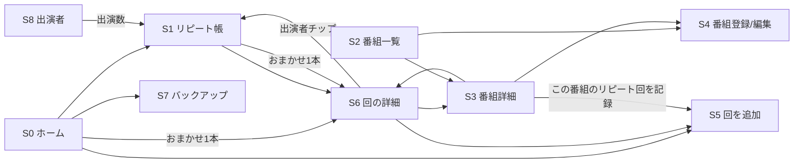

# システム要求仕様

最終更新：2026-11-26 ／ 対象バージョン：1.0.0 ／ DB スキーマ：v1

> 実装の「何を・なぜ」をまとめたものです。コードを変えたら、関係する節（特に 5〜8 章と 11 章）も更新してください。
> 要求には ID を振っています（FR=機能要求、NFR=非機能要求、DR=データ要求）。相談するときは ID で指すと話が早いです。

---

## 1. 目的と範囲

- **目的**：ラジオ／ポッドキャストの「また聴きたい回」を、放送日・番組・出演者・理由メモとともにストックし、あとで探して聴き返せるようにする。
- **利用者**：個人（シングルユーザー）。アカウント・ログインなし。
- **範囲外**：音声の再生・録音、放送局サービス（radiko 等）との連携、複数端末の自動同期、他ユーザーとのデータ共有。

## 2. 前提・制約

| ID | 制約 |
| --- | --- |
| C-1 | **無料で運用**する。有料サービス・独自ドメイン・サーバーは使わない |
| C-2 | **法令・各サービス規約に違反しない**（外部 API は公開・無料・キー不要のもののみ、規約の範囲で） |
| C-3 | リポジトリは **Public**。コード・テスト・ドキュメントに**個人情報や実在の個人聴取ログを含めない**。サンプルは「架空〜」で作る |
| C-4 | データは**端末のブラウザ内（IndexedDB）にのみ**保存し、外部に送らない |
| C-5 | 公開は **GitHub Pages のサブパス**（`/radio-log/`）。`main` への push で GitHub Actions が自動デプロイ |
| C-6 | 開発者はスマホ中心で操作する。ローカルで npm を使えない前提でも、push すれば CI がビルドする構成にする |

## 3. 技術構成

| 項目 | 採用 | 理由 |
| --- | --- | --- |
| UI | React 19 + TypeScript（strict） | 型安全・保守性 |
| ビルド | Vite 7 + `@vitejs/plugin-react` | 高速、GitHub Pages 用 `base` 設定が容易 |
| PWA | `vite-plugin-pwa`（Workbox、`registerType: 'prompt'`） | オフライン起動、更新は利用者が「更新」を押して反映 |
| ルーティング | `react-router-dom` の `HashRouter` | GitHub Pages のサブパスで 404 を出さない |
| DB | IndexedDB（自前の型付きラッパー `src/db/idb.ts`） | 依存を減らし、トランザクションを明示的に制御 |
| スタイル | 素の CSS ＋ CSS 変数（`src/styles.css`） | 依存なし。レトロアメリカン・ラジオ調ライトテーマ |
| アイコン | `assets/icon.svg` から `sharp` でビルド前に PNG 生成 | バイナリをリポジトリに置かない |
| CI/CD | `.github/workflows/deploy.yml` | push → `npm ci/install` → `npm run build` → Pages へデプロイ |

### ディレクトリ

```
src/
  db/          types.ts / idb.ts（接続・トランザクション）/ repo.ts（CRUD・整合性）/ backup.ts（JSON 検証）
  state/       DataContext.tsx（全データのスナップショットと派生 Map）
  lib/         util.ts（日付・正規化・検索）/ external.ts（iTunes・Wikipedia）/ suggest.ts（よく出る人）
               shareImage.ts（Canvas 描画）/ backupActions.ts（共有・最終バックアップ管理）/ stations.ts
  components/  Layout（ヘッダー・下部ナビ）, UiProvider（確認ダイアログ・トースト）, PersonPicker,
               PersonListEditor, ProgramNameSuggest, StationChips, SuggestInput, LogCard,
               RandomPickModal, ShareImageModal, BackupReminder, GuideContent, UpdateBanner
  pages/       HomePage, LogListPage, LogFormPage, LogDetailPage, ProgramListPage, ProgramDetailPage,
               ProgramFormPage, PersonsPage, DataPage
docs/          この設計ドキュメント
```

## 4. 画面一覧と遷移

| ID | 画面 | ルート | 下部ナビ |
| --- | --- | --- | --- |
| S0 | ホーム | `#/` | ホーム |
| S1 | リピート帳（一覧） | `#/logs`（`?person=ID`…、`?sort=`） | リピート帳 |
| S2 | 番組一覧 | `#/programs` | 番組 |
| S3 | 番組詳細 | `#/programs/:id` | |
| S4 | 番組登録／編集 | `#/programs/new`、`#/programs/:id/edit` | |
| S5 | 回の追加／編集 | `#/logs/new`（`?programId=`）、`#/logs/:id/edit` | ＋回を追加（中央） |
| S6 | 回の詳細 | `#/logs/:id` | |
| S7 | データのバックアップ | `#/data` | （ホームから） |
| S8 | 出演者 | `#/persons` | 出演者 |

旧ルート `#/guide` は `#/` へリダイレクト。未知のルートも `#/` へ。



## 5. 機能要求（FR）

### S0 ホーム
- **FR-0-1** アプリ名とキャッチコピー「ラジオの『また聴きたい回』をストックするアプリ」を表示する。
- **FR-0-2** 主操作：「＋ また聴きたい回を追加」（番組が0件なら「① まず番組を登録する」）、「🎲 おまかせ1本」（回が1件以上）。
- **FR-0-3** 最近追加した3件（`createdAt` 降順）と「リピート帳をすべて見る（N件）」。
- **FR-0-4** 記録数（リピート回／番組／出演者）。すべて0なら非表示。
- **FR-0-5** データのバックアップ欄：最終バックアップ日、「📤 今すぐ送る」、S7 への導線。**使い方ガイドの上**に置く。
- **FR-0-6** 使い方ガイド（3ステップ・下部ナビの意味・FAQ）。回が3件未満なら開いた状態、以降は畳む。ガイドは**ホームにのみ**置く。
- **FR-0-7** バックアップのお知らせ（FR-7-4）をホーム上部に出す。

### S1 リピート帳
- **FR-1-1** 並び順：新しい順（既定）／古い順／番組ごと／追加した順。選択は URL `?sort=` と localStorage `radiolog.sort` に保持。
  - 新しい順は `broadcastDate` 降順 → `createdAt` 降順 → `id` で決定的に並べる。
  - 番組ごとは番組名（日本語照合順）で見出し付きグループ、グループ内は新しい順。見出しから S3 へ。
- **FR-1-2** 出演者フィルタ：複数選択は **AND**。`name` と `aliases` で検索。未入力でタップすると「よく出る人」（出演回数順・最大8）を候補表示。選択は URL `?person=` に保持。
- **FR-1-3** カード：放送日（曜日）・番組名・放送局・出演者（ゲストは色違い）・メモ3行まで。タップで S6。
- **FR-1-4** 🎲 おまかせ1本（右下固定）：対象＝表示中の絞り込み結果。対象が2件以上なら**直前と同じ回を除外**。結果は「TUNED IN!」演出付きカード（詳細を見る／引き直す／閉じる）。対象が1件なら引き直し不可。
- **FR-1-5** 📷 上位N件をシェア：表示順の上位最大5件で画像生成（FR-6-3）。
- **FR-1-6** 0件時は空状態（追加ボタンとホームへの導線）。フィルタ・並び順・おまかせは非表示。

### S2 番組一覧
- **FR-2-1** 番組名・放送局で検索。入力中に候補（最大6、リピート回数付き）を出し、タップで S3。
- **FR-2-2** 各番組のリピート記録回数を表示。S4 への導線。

### S3 番組詳細
- **FR-3-1** 番組名・放送局・基本パーソナリティ（タップで S1 絞り込み）・記録回数。
- **FR-3-2** 「この番組のリピート回を記録」→ S5（番組選択済み・今日・基本パーソナリティ入り）。
- **FR-3-3** その番組の回一覧（新しい順）。

### S4 番組登録／編集
- **FR-4-1** 番組名（必須・トリム）、放送局（任意）、基本パーソナリティ（並び替え可）。
- **FR-4-2** 番組名を**入力するだけで** Apple Podcasts の候補を表示（2文字以上・入力停止 700ms 後・同じ語はキャッシュ・編集画面を開いただけでは検索しない）。選択で番組名を入力し、提供者名が既知の局に一致すれば放送局も入力。
- **FR-4-3** 候補の下に「Apple Podcasts にある番組のみ。radiko のみ・Spotify 独占は出ない」旨を表示。同名の登録済み番組があれば警告。
- **FR-4-4** 放送局チップ：登録済みの局（使用回数順）→ 主要局プリセット（`src/lib/stations.ts`）。再タップで解除。
- **FR-4-5** 削除：確認ダイアログ。リピート回が残っていれば削除ブロックし件数を表示。

### S5 回の追加／編集
- **FR-5-1** 番組（最近の番組チップ最大8件＋セレクト）、放送日（`type="date"`、初期値＝ローカルの今日）、出演者、メモ。
- **FR-5-2** 番組選択時、出演者を手で触っていなければ基本パーソナリティ（regular）で置き換え、触っていれば不足分だけ追加（重複なし）。編集時は既存の出演者を保持。
- **FR-5-3** 「↺ 前回（日付）と同じ出演者にする」：同番組の直近回（編集中の回を除く）の出演者・役割・順序を反映。同じ構成なら非表示。
- **FR-5-4** 「よく出る人」候補（最大6）：スコア＝全体出演 +1、同番組 +3、選択中の人との共演 +2×人数。
- **FR-5-5** 出演者の追加（名前・別名サジェスト、新規作成、Wikipedia 候補）、並び替え、レギュラー/ゲスト切り替え、削除。手動追加はゲストが初期値。
- **FR-5-6** 保存時、新規または番組/放送日を変えた場合に、同番組・同放送日の既存回があれば確認（そのまま登録／キャンセル）。

### S6 回の詳細
- **FR-6-1** 放送日・番組（タップで S3）・出演者チップ（タップで S1 絞り込み）・メモ全文。
- **FR-6-2** 「シェア画像を作成」：1回分の PNG（1080×1350、ファイル名 `radio-log-YYYY-MM-DD.png`）。
- **FR-6-3** シェア画像は **Canvas に直接描画**（外部フォント・外部画像なし）。デザインはカセットのインデックスカード風（チューニング目盛り・REPEAT ARCHIVE）。出演者は3行まで＋「ほかN名」、メモは行数制限＋「…」、メモなしでも罫線を描く。プレビュー → 「共有する」（`navigator.canShare({files})` 対応時のみ）／「画像を保存」。
- **FR-6-4** 編集（S5）・削除（確認ダイアログ）。別の回へ移動したらシェア画面を閉じる。

### S7 データのバックアップ
- **FR-7-1** 「📤 バックアップを送る」：共有シートで JSON を渡す。`.json` が共有不可なら同内容の `.txt`（Android Chrome 対策）、共有不可環境ではダウンロード。キャンセル時は何もしない。
- **FR-7-2** 「この端末にファイルを保存」：`radio-log-backup-YYYYMMDD-HHMMSS.json` をダウンロード。
- **FR-7-3** 復元（置き換え）：`.json`/`.txt` を検証 → 現在と取り込みの件数比較を含む破壊的操作の確認 → 1トランザクションで全消去＋投入。
- **FR-7-4** 最終バックアップ日時を localStorage `radiolog.lastBackupAt` に記録。回が1件以上かつ未バックアップまたは **14日以上**経過でお知らせ。「あとで」で **3日**スヌーズ（`radiolog.backupSnoozeUntil`）。
- **FR-7-5** 保存場所・外部送信・ストレージ永続化の状態を説明し、未許可なら永続化をリクエストできる。

### S8 出演者
- **FR-8-1** 名前・別名で検索、入力中に候補（出演回数付き）、タップで編集。
- **FR-8-2** 表示名（必須）・別名（「、」「,」区切り、空・重複・表示名と同じものは除外）を編集。同名がいれば確認。
- **FR-8-3** 削除は参照チェック（DR-3）。

### 共通
- **FR-C-1** 下部ナビ：ホーム／リピート帳／＋回を追加（中央の大ボタン）／番組／出演者。
- **FR-C-2** 各画面の上部に一行説明（何の画面か、登録しただけではお気に入りにならないこと 等）。
- **FR-C-3** 確認ダイアログ・トーストは共通の `UiProvider` で出す。
- **FR-C-4** 検索の正規化：NFKC、小文字化、カタカナ→ひらがな、空白除去（`normalizeForSearch`）。

## 6. データ要求（DR）

DB 名 `radio_log_db`、バージョン **1**（`src/db/idb.ts` の `DB_VERSION`）。ID は `crypto.randomUUID()`（非対応時は v4 互換のフォールバック）。日時は ISO 8601。

| ストア | キー | フィールド | インデックス |
| --- | --- | --- | --- |
| `programs` | `id` | `name`（必須・トリム）, `station`, `defaultPersonIds: string[]`, `createdAt`, `updatedAt` | — |
| `persons` | `id` | `name`（必須・トリム）, `aliases: string[]`, `createdAt`, `updatedAt` | — |
| `episodeLogs` | `id` | `programId`, `broadcastDate`（`YYYY-MM-DD`）, `memo`, `createdAt`, `updatedAt` | `by_program`, `by_program_date`（`[programId, broadcastDate]`）, `by_date` |
| `episodeAppearances` | `id` | `episodeLogId`, `personId`, `role: 'regular' \| 'guest'`, `sortOrder`（0始まり） | `by_log`, `by_person` |

- **DR-1** 回の保存は `episodeLogs` と `episodeAppearances` を**同一トランザクション**で（既存出演を全削除 → 新規追加）。
- **DR-2** 回の削除は、その回の `episodeAppearances` 削除と `episodeLogs` 削除を**同一トランザクション**で。
- **DR-3** 人物の削除は、`programs.defaultPersonIds` または `episodeAppearances` で参照されていれば**ブロック**し、「基本パーソナリティの番組名」「番組別の出演件数」を表示する。
- **DR-4** 番組の削除は、`episodeLogs` に参照があればブロック。
- **DR-5** インポートは全4ストアの消去と投入を**1トランザクション**で行い、途中失敗時は元データを保持する。
- **DR-6** スキーマ変更時は `DB_VERSION` を上げ、`upgrade()` に `oldVersion` ごとの移行処理を追加する。バックアップの `schemaVersion` も同値。新しい形式のファイルは古いアプリでは取り込み拒否する。

### バックアップ形式（JSON）

```json
{
  "appName": "radio-log",
  "schemaVersion": 1,
  "exportedAt": "2026-11-26T09:00:00.000Z",
  "programs": [], "persons": [], "episodeLogs": [], "episodeAppearances": []
}
```

検証内容：`appName`、`schemaVersion`（整数・アプリ以下）、4配列の存在、各レコードの型、ID 重複、参照整合性（番組・人物・回）、日付形式、`role` の値。

### ブラウザに保存するその他の値（localStorage）

| キー | 用途 |
| --- | --- |
| `radiolog.sort` | リピート帳の並び順 |
| `radiolog.lastBackupAt` | 最終バックアップ日時 |
| `radiolog.backupSnoozeUntil` | お知らせのスヌーズ期限 |

## 7. 外部連携

| 連携先 | 用途 | 呼び出し条件 | 方式・配慮 |
| --- | --- | --- | --- |
| iTunes Search API（Apple Podcasts） | 番組名候補 | S4 で番組名を入力（2文字以上・700ms 後） | CORS 非対応のため公式 JSONP（`callback`）。`media=podcast&country=JP`。上限 約20回/分 → デバウンス＋キャッシュ。アートワーク画像は表示しない（素材はストアバッジ近傍で使う規約への配慮） |
| Wikipedia（ja）Action API | 人名候補 | 「📖 Wikipediaで候補を検索」押下時のみ | `origin=*` の匿名 CORS。`Api-User-Agent: RadioLog/1.0 (https://github.com/satoshibjj/radio-log)` を付与（Wikimedia の User-Agent ポリシー）。タイトルのみ利用、括弧の曖昧さ回避を除去、曖昧さ回避ページは除外。「出典: Wikipedia」を表示 |
| Web Share API | 画像・バックアップの共有 | ボタン押下時 | `navigator.canShare({ files })` で判定し、非対応ならダウンロード |

- 送信するのは**検索語のみ**。記録データは外部に送らない。
- オフライン時は「オフラインのため検索できません」と表示し、入力の妨げにしない（タイムアウト 8 秒）。

## 8. 非機能要求（NFR）

| ID | 区分 | 要求 |
| --- | --- | --- |
| NFR-1 | 操作性 | モバイルファースト。タップ領域 44px 以上。主要操作は画面下部（親指の届く位置） |
| NFR-2 | 操作性 | 入力欄は 16px 以上（iOS のズーム防止）。フォームは迷わない順序（番組 → 放送日 → 出演者 → メモ） |
| NFR-3 | オフライン | Service Worker で全静的ファイルをプリキャッシュし、オフラインで起動・記録できる |
| NFR-4 | 更新 | 新しいバージョンを検知したらバナーで通知し、利用者の操作で更新する |
| NFR-5 | データ保護 | 起動時に `navigator.storage?.persist?.()` を要求（例外は握りつぶす） |
| NFR-6 | プライバシー | データは端末内のみ。外部送信は 7 章の検索語に限定。画面と README に明記 |
| NFR-7 | 安全性 | 破壊的操作（削除・置き換え復元）は必ず確認ダイアログ |
| NFR-8 | 互換性 | iOS Safari / Android Chrome の最新版。HashRouter でサブパス配信に対応 |
| NFR-9 | 描画の安定性 | シェア画像は Canvas 直接描画（CORS による白紙化を防ぐ） |
| NFR-10 | アクセシビリティ | ボタンは見えている文言とアクセシブルネームを一致させる。`prefers-reduced-motion` で演出を止める |
| NFR-11 | 費用 | すべて無料枠（GitHub Pages / Actions、キー不要の API） |

## 9. デザイン方針

- テーマ：ライトモードの「古いアメリカンラジオ」。紙＝`#F6F1E7`/`#EFE7D6`、ラスト＝`#C84B31`、インク＝`#2B2623`、真鍮＝`#B8860B`、ゲスト用ティール＝`#3F6E6A`（`src/styles.css` の `:root`）。
- 装飾：ヘッダー下のダイヤル目盛りとチューニング針、件数のメーター風表示、真空管の灯り風の見出し点。
- 文言：画面上の用語は「リピート帳」「また聴きたい回」「回を追加」「番組」「出演者」に統一。

## 10. 公開・運用

- 公開 URL：https://satoshibjj.github.io/radio-log/ （リポジトリ https://github.com/satoshibjj/radio-log 。旧ユーザー名 MuscleStrong1 から改名済み）
- `vite.config.ts` の `base` は `/radio-log/`（ユーザー名に依存しない）。
- デプロイ：`main` への push → Actions「Deploy to GitHub Pages」。初回のみ Settings → Pages → Source を「GitHub Actions」に。
- URL（オリジン）を変えると別アプリ扱いになり、データは引き継がれない。変更前にバックアップ → 新 URL で復元。

## 11. 検証の観点（受け入れチェックリスト）

機能を変えたら、少なくとも次を確認する（過去は Playwright の E2E で自動確認していた。テストコードはリポジトリ外）。

- [ ] `npm run build` が通る（型チェック含む）。Actions が緑
- [ ] 番組登録 → 回の追加 → 詳細 → 編集 → 削除（出演者も同時に消える）
- [ ] 同番組・同日の重複確認が出る／キャンセルで保存されない
- [ ] 出演者 AND 絞り込み、詳細の出演者チップから絞り込み
- [ ] 並び替え4種と保持、番組ごとの見出し
- [ ] おまかせ1本：連続で同じ回が出ない、絞り込み中はその中から
- [ ] 人物・番組の削除ブロック（参照内容の表示）
- [ ] バックアップ送信（.json/.txt）、ファイル保存、復元（不正ファイルは拒否してデータ不変）
- [ ] シェア画像（1回・上位5件）が 1080×1350 で出る
- [ ] オフライン起動、外部検索のオフライン表示
- [ ] 画面・コードに個人情報や実在の聴取ログが入っていない

## 12. 意思決定の記録（主なもの）

| 日付 | 決定 | 理由 |
| --- | --- | --- |
| 2026-11-26 | コンセプトを「全聴取ログ」から「また聴きたい回だけ」に変更 | 記録の手間を減らし、見返す価値に集中 |
| 2026-11-26 | IndexedDB ラッパーを自前実装（`idb` 不使用） | 依存削減、トランザクション制御を明示 |
| 2026-11-26 | iTunes は JSONP、Wikipedia は `origin=*` | ブラウザだけで無料・キー不要で呼ぶため |
| 2026-11-26 | Spotify 検索・メール自動送信・有名番組データ同梱は不採用 | 7 章／USM「やらないと決めたこと」参照 |
| 2026-11-26 | バックアップは共有シート方式＋14日リマインド | 無料・鍵不要・データが第三者を経由しない |
| 2026-11-26 | 下部ナビは5枠、バックアップはホームのガイド上 | スマホ幅での押しやすさ |
| 2026-11-26 | GitHub ユーザー名を satoshibjj に変更 | 公開 URL に旧名を出さないため |
